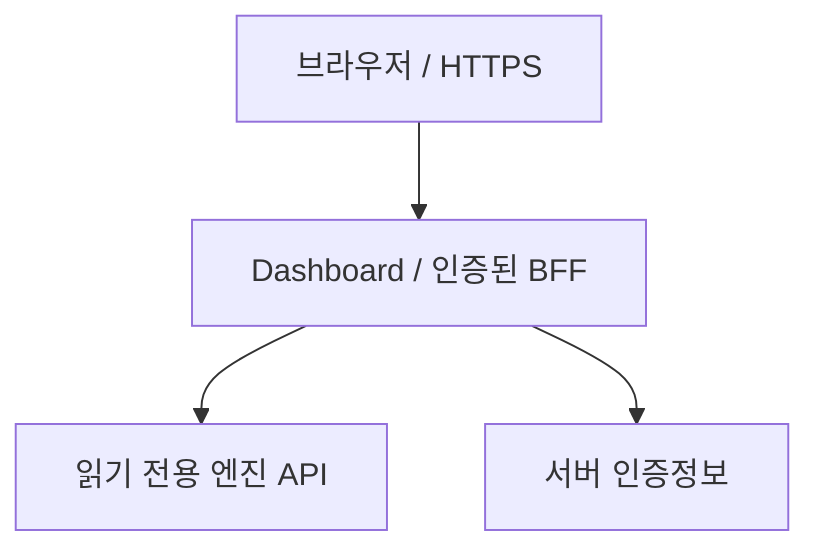

# TQQQ 200d MA Strategy Dashboard 시스템 구성

Dashboard는 엔진의 읽기 전용 API로 운영 상태와 거래 정보를 조회한다. 엔진 주소와 인증정보는 실행 환경에서 주입하며, Dashboard는 DB에 직접 연결하지 않는다.

공개 저장소에는 주소, 자원 ID, ARN과 자격 증명을 채운 운영 설정을 포함하지 않는다. `.env.example`의 공란과 배포 템플릿의 `REPLACE_*`는 사용 환경에서 별도로 설정한다.

공개 합성 Mock, 인증된 Dashboard/BFF 경계를 구분한다. 엔진 장애를 Mock이나 이전 정상 상태로 대체하지 않는다. Secret은 서버에서만 읽고 응답 허용 목록, no-store, GET 전용, timeout과 요청 제한을 적용한다. 실제 시세 어댑터는 미연결 상태다.

배포 예시는 Dashboard만 대상으로 한다. 실행 설정과 템플릿 사용법은 [배포 문서](DEPLOYMENT.md)를 따른다.

## 구현 구조

| 경로 | 역할 |
|---|---|
| src/app | App Router 페이지, BFF, 웹 /healthz |
| src/components | 레이아웃, 차트, 상태, 거래 테이블, 상세 화면 |
| src/lib/contracts.ts | 엔진 응답의 허용 필드와 런타임 검증 |
| src/lib/server/engine.ts | GET 전용 엔진 어댑터, 타임아웃, 페이지 조회 |
| src/lib/server/market.ts | 합성 시세와 미연결 실제 시세 경계 |
| src/lib/server/auth.ts | 조회 사용자 인증, 자격 증명 검증 |
| src/lib/mock.ts | 실제 데이터와 분리한 고정 합성 fixture |
| deploy | Dashboard용 ECS, Compose와 Nginx 설정 예시 |
| tests | 정밀도, 계약, 인증, 장애 처리와 브라우저 검증 |

## 구현 기준

Next.js App Router, strict TypeScript와 `@/*` 경로를 사용한다. 코드는 2칸 들여쓰기, 큰따옴표, 세미콜론과 함수 컴포넌트 방식으로 작성한다.

Noto Sans KR 가변 폰트를 `next/font/local`로 제공한다. 빌드가 Google Fonts 연결에 의존하지 않도록 [Google Fonts 원본](https://github.com/google/fonts/tree/main/ofl/notosanskr)과 OFL을 함께 보존한다. 원본 TTF는 약 10.4 MB이며 글꼴 분할 최적화는 추후 검토 대상이다.

메인 `/`와 `/strategy`, `/market`, `/trades`, `/portfolio`, `/engine`은 동일 서버 인증 경계를 사용한다. 상세 화면은 기존 컴포넌트를 재사용하고, 합성 화면은 `/demo` 하위로 분리한다. 기존 도메인·이미지·Task Definition과 별도 Fargate Service 배포 예시는 유지한다.
